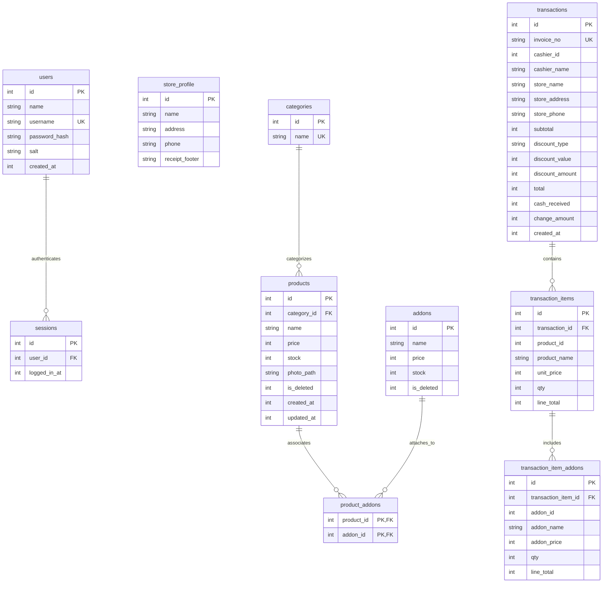

# Skema Database v1 - Vonte PoS

Dokumen ini mendefinisikan skema basis data SQLite v1 untuk aplikasi **Vonte PoS** berdasarkan spesifikasi di [AGENTS.md](../AGENTS.md). 

Semua tabel dirancang untuk kebutuhan aplikasi kasir 100% offline dengan keandalan tinggi, perlindungan integritas finansial melalui snapshot data, dan pelacakan historis melalui soft delete.

---

## 1. Konfigurasi Dasar Basis Data

- **DBMS:** SQLite via paket Flutter `sqflite`.
- **Integritas Foreign Key:** Wajib diaktifkan manual pada callback `onConfigure` menggunakan:
  ```sql
  PRAGMA foreign_keys = ON;
  ```
- **Strategi Migrasi:** Skema menggunakan sistem migrasi berversi (`version: 1`) sejak awal pembentukan database.
- **Tipe Data Uang:** Seluruh nilai mata uang (rupiah) disimpan menggunakan tipe data `INTEGER` (tanpa floating point atau `REAL`) untuk mencegah *precision loss*.
- **Tipe Data Waktu:** Disimpan dalam format integer epoch milliseconds UTC (`INTEGER`) dan diformat ke representasi lokal hanya pada presentation layer.

---

## 2. Diagram Relasi Entitas (ERD)

Diagram berikut menggambarkan relasi antar entitas pada skema v1:



---

## 3. Rincian Tabel Skema v1

### 3.1. `users`
Menyimpan akun pengguna / kasir untuk autentikasi offline.

| Kolom | Tipe SQLite | Constraints / Default | Foreign Key | Alasan Desain & Peran Bisnis |
|---|---|---|---|---|
| `id` | `INTEGER` | `PRIMARY KEY AUTOINCREMENT` | - | Identifikator unik akun kasir. |
| `name` | `TEXT` | `NOT NULL` | - | Nama lengkap kasir untuk ditampilkan di UI dan dicetak di struk. |
| `username` | `TEXT` | `NOT NULL UNIQUE` | - | Kredensial masuk kasir; unik dan divalidasi case-insensitive. |
| `password_hash` | `TEXT` | `NOT NULL` | - | Hash password hasil kombinasi SHA-256 password dan salt. |
| `salt` | `TEXT` | `NOT NULL` | - | Salt acak aman unik per pengguna untuk mencegah serangan dictionary/rainbow table. |
| `created_at` | `INTEGER` | `NOT NULL` | - | Timestamp epoch ms pembuatan akun kasir. |

---

### 3.2. `sessions`
Menyimpan status sesi aktif aplikasi secara offline.

| Kolom | Tipe SQLite | Constraints / Default | Foreign Key | Alasan Desain & Peran Bisnis |
|---|---|---|---|---|
| `id` | `INTEGER` | `PRIMARY KEY AUTOINCREMENT` | - | Identifikator unik baris sesi. |
| `user_id` | `INTEGER` | `NOT NULL` | `REFERENCES users(id) ON DELETE CASCADE` | Menghubungkan sesi ke kasir yang sedang aktif masuk. |
| `logged_in_at` | `INTEGER` | `NOT NULL` | - | Timestamp waktu kasir berhasil login. |

> **Catatan:** Maksimal hanya ada satu baris aktif dalam tabel ini. Layar *Splash* membaca tabel ini untuk menentukan apakah pengguna langsung masuk ke layar Kasir atau ke layar Login.

---

### 3.3. `store_profile`
Menyimpan identitas profil gerai / toko yang dicetak pada struk belanja.

| Kolom | Tipe SQLite | Constraints / Default | Foreign Key | Alasan Desain & Peran Bisnis |
|---|---|---|---|---|
| `id` | `INTEGER` | `PRIMARY KEY` | - | Identifikator tunggal profil toko (selalu baris tunggal, `id = 1`). |
| `name` | `TEXT` | `NOT NULL` | - | Nama toko yang dicetak di kepala struk (header). |
| `address` | `TEXT` | `NOT NULL` | - | Alamat toko untuk struk. |
| `phone` | `TEXT` | `NOT NULL` | - | Nomor telepon toko untuk struk. |
| `receipt_footer` | `TEXT` | `NOT NULL` | - | Pesan penutup struk (misal: "Terima kasih atas kunjungan Anda"). |

> **Catatan:** Tabel ini di-seed dengan 1 baris data netral saat instalasi awal dan dapat diubah melalui tab Pengaturan.

---

### 3.4. `categories`
Menyimpan kategori produk untuk pengelompokan dan navigasi filter di kasir.

| Kolom | Tipe SQLite | Constraints / Default | Foreign Key | Alasan Desain & Peran Bisnis |
|---|---|---|---|---|
| `id` | `INTEGER` | `PRIMARY KEY AUTOINCREMENT` | - | Identifikator unik kategori. |
| `name` | `TEXT` | `NOT NULL UNIQUE` | - | Nama kategori (misal: Kopi, Makanan, Minuman); unik tanpa peka huruf besar/kecil. |

---

### 3.5. `products`
Menyimpan katalog produk utama yang dijual.

| Kolom | Tipe SQLite | Constraints / Default | Foreign Key | Alasan Desain & Peran Bisnis |
|---|---|---|---|---|
| `id` | `INTEGER` | `PRIMARY KEY AUTOINCREMENT` | - | Identifikator unik produk. |
| `category_id` | `INTEGER` | `NULL` | `REFERENCES categories(id) ON DELETE SET NULL` | Mengelompokkan produk ke kategori; jika kategori dihapus, produk menjadi tanpa kategori (`NULL`). |
| `name` | `TEXT` | `NOT NULL` | - | Nama produk makanan/minuman/barang. |
| `price` | `INTEGER` | `NOT NULL` | - | Harga jual satuan produk dalam integer rupiah (> 0). |
| `stock` | `INTEGER` | `NOT NULL` | - | Sisa stok produk fisik yang tersedia (>= 0). |
| `photo_path` | `TEXT` | `NULL` | - | Path relatif file foto terhadap folder dokumen aplikasi (misal: `product_images/xyz.jpg`). |
| `is_deleted` | `INTEGER` | `NOT NULL DEFAULT 0` | - | Flag soft delete (`0` = aktif, `1` = terhapus). |
| `created_at` | `INTEGER` | `NOT NULL` | - | Waktu produk pertama kali ditambahkan (epoch ms). |
| `updated_at` | `INTEGER` | `NOT NULL` | - | Waktu data produk terakhir diubah (epoch ms). |

---

### 3.6. `addons`
Menyimpan master varian / add-on / topping tambahan yang memiliki stok tersendiri.

| Kolom | Tipe SQLite | Constraints / Default | Foreign Key | Alasan Desain & Peran Bisnis |
|---|---|---|---|---|
| `id` | `INTEGER` | `PRIMARY KEY AUTOINCREMENT` | - | Identifikator unik add-on. |
| `name` | `TEXT` | `NOT NULL` | - | Nama add-on (misal: Extra Shot, Oat Milk, Boba). |
| `price` | `INTEGER` | `NOT NULL` | - | Tambahan harga dalam rupiah (>= 0). |
| `stock` | `INTEGER` | `NOT NULL` | - | Sisa kuantitas stok add-on fisik yang tersedia (>= 0). |
| `is_deleted` | `INTEGER` | `NOT NULL DEFAULT 0` | - | Flag soft delete (`0` = aktif, `1` = terhapus). |

---

### 3.7. `product_addons`
Tabel perantara (*junction table*) relasi many-to-many antara produk dan add-on yang tersedia untuk produk tersebut.

| Kolom | Tipe SQLite | Constraints / Default | Foreign Key | Alasan Desain & Peran Bisnis |
|---|---|---|---|---|
| `product_id` | `INTEGER` | `NOT NULL` | `REFERENCES products(id) ON DELETE CASCADE` | Relasi ke produk terkait. |
| `addon_id` | `INTEGER` | `NOT NULL` | `REFERENCES addons(id) ON DELETE CASCADE` | Relasi ke add-on yang dapat dipasangkan. |

> **Primary Key Gabungan:** `PRIMARY KEY (product_id, addon_id)` untuk memastikan satu varian add-on tidak dapat dipasangkan ganda pada satu produk yang sama.

---

### 3.8. `transactions`
Menyimpan header rekaman transaksi penjualan, lengkap dengan informasi snapshot toko dan kasir.

| Kolom | Tipe SQLite | Constraints / Default | Foreign Key | Alasan Desain & Peran Bisnis |
|---|---|---|---|---|
| `id` | `INTEGER` | `PRIMARY KEY AUTOINCREMENT` | - | Identifikator unik transaksi. |
| `invoice_no` | `TEXT` | `NOT NULL UNIQUE` | - | Nomor struk transaksi terurut harian (format: `VNT-YYYYMMDD-0001`). |
| `cashier_id` | `INTEGER` | `NOT NULL` | - | Referensi ID kasir yang bertugas saat transaksi terjadi. |
| `cashier_name` | `TEXT` | `NOT NULL` | - | **Snapshot** nama kasir saat transaksi terjadi. |
| `store_name` | `TEXT` | `NOT NULL` | - | **Snapshot** nama toko saat transaksi terjadi. |
| `store_address` | `TEXT` | `NOT NULL` | - | **Snapshot** alamat toko saat transaksi terjadi. |
| `store_phone` | `TEXT` | `NOT NULL` | - | **Snapshot** nomor telepon toko saat transaksi terjadi. |
| `subtotal` | `INTEGER` | `NOT NULL` | - | Total kotor sebelum diskon (dalam rupiah). |
| `discount_type` | `TEXT` | `NOT NULL` | - | Tipe diskon yang digunakan (`'percent'`, `'fixed'`, atau `'none'`). |
| `discount_value` | `INTEGER` | `NOT NULL` | - | Besaran diskon yang diinput (persen 0..100 atau rupiah nominal). |
| `discount_amount`| `INTEGER` | `NOT NULL` | - | Nilai potongan rupiah final hasil kalkulasi integer half-up. |
| `total` | `INTEGER` | `NOT NULL` | - | Total tagihan bersih akhir (`subtotal - discount_amount`). |
| `cash_received` | `INTEGER` | `NOT NULL` | - | Jumlah nominal uang tunai yang diterima dari pembeli. |
| `change_amount` | `INTEGER` | `NOT NULL` | - | Uang kembalian yang diberikan (`cash_received - total`). |
| `created_at` | `INTEGER` | `NOT NULL` | - | Waktu transaksi difinalisasi (epoch ms UTC). |

---

### 3.9. `transaction_items`
Menyimpan rincian produk yang dibeli pada setiap transaksi penjualan.

| Kolom | Tipe SQLite | Constraints / Default | Foreign Key | Alasan Desain & Peran Bisnis |
|---|---|---|---|---|
| `id` | `INTEGER` | `PRIMARY KEY AUTOINCREMENT` | - | Identifikator unik baris item transaksi. |
| `transaction_id`| `INTEGER` | `NOT NULL` | `REFERENCES transactions(id) ON DELETE CASCADE` | Menghubungkan item ke header transaksi induknya. |
| `product_id` | `INTEGER` | `NOT NULL` | - | Referensi ID produk asli (reference only, tanpa foreign key ketat). |
| `product_name` | `TEXT` | `NOT NULL` | - | **Snapshot** nama produk saat dibeli. |
| `unit_price` | `INTEGER` | `NOT NULL` | - | **Snapshot** harga satuan produk saat dibeli (rupiah). |
| `qty` | `INTEGER` | `NOT NULL` | - | Jumlah unit produk yang dibeli pada baris ini. |
| `line_total` | `INTEGER` | `NOT NULL` | - | Total harga baris produk sebelum add-on (`unit_price * qty`). |

---

### 3.10. `transaction_item_addons`
Menyimpan rincian add-on yang melekat pada baris produk tertentu dalam transaksi.

| Kolom | Tipe SQLite | Constraints / Default | Foreign Key | Alasan Desain & Peran Bisnis |
|---|---|---|---|---|
| `id` | `INTEGER` | `PRIMARY KEY AUTOINCREMENT` | - | Identifikator unik baris add-on transaksi. |
| `transaction_item_id` | `INTEGER` | `NOT NULL` | `REFERENCES transaction_items(id) ON DELETE CASCADE` | Menghubungkan add-on ke baris item transaksi yang bersangkutan. |
| `addon_id` | `INTEGER` | `NOT NULL` | - | Referensi ID add-on asli (reference only, tanpa foreign key ketat). |
| `addon_name` | `TEXT` | `NOT NULL` | - | **Snapshot** nama add-on saat dibeli. |
| `addon_price` | `INTEGER` | `NOT NULL` | - | **Snapshot** harga satuan add-on saat dibeli (rupiah). |
| `qty` | `INTEGER` | `NOT NULL` | - | Kuantitas add-on untuk baris item tersebut. |
| `line_total` | `INTEGER` | `NOT NULL` | - | Total biaya add-on pada baris ini (`addon_price * qty`). |

---

## 4. Rasionalisasi Keputusan Desain

### Mengapa Menggunakan Kolom Snapshot?
Kolom snapshot terdapat pada tabel `transactions` (`store_name`, `store_address`, `store_phone`, `cashier_name`), `transaction_items` (`product_name`, `unit_price`), dan `transaction_item_addons` (`addon_name`, `addon_price`).

1. **Imutabilitas Transaksi Finansial:**
   Struk belanja dan laporan keuangan adalah catatan historis yang sah. Jika pemilik toko menaikkan harga "Kopi Susu" dari Rp15.000 menjadi Rp18.000 minggu depan, transaksi yang terjadi hari ini tidak boleh berubah nilainya saat struk dicetak ulang atau laporan bulanan ditarik.
2. **Kemandirian Kueri Laporan & Struk:**
   Layar riwayat, pratinjau struk, dan laporan omzet dapat mengambil data secara instan hanya dari tabel transaksi tanpa perlu melakukan operasi `JOIN` ke tabel master produk atau profil toko. Hal ini menjaga kueri tetap ringan dan cepat.
3. **Ketahanan Terhadap Perubahan Master Data:**
   Jika master produk diubah namanya, dikosongkan kategorinya, atau dihapus, struk lama tidak akan menampilkan data kosong (*null*), harga Rp0, atau mengalami *runtime exception*.

### Mengapa Menggunakan Soft Delete (`is_deleted`)?
Kolom `is_deleted` diterapkan pada tabel `products` dan `addons`.

1. **Menjaga Integritas Referensi Historis:**
   Operasi penghapusan fisik (*hard delete* / `DELETE FROM products WHERE id = ?`) berisiko merusak integritas referensi atau menyebabkan konflik foreign key pada relasi data. Dengan *soft delete*, baris data fisik tetap tersimpan di database.
2. **Pemisahan Visibilitas Kasir vs Jejak Audit:**
   Baris dengan `is_deleted = 1` langsung disaring keluar dari katalog kasir aktif dan form manajemen produk harian. Namun, jika tim audit atau manajer toko ingin menelusuri riwayat penjualan produk lama melalui `product_id`, data entitas tersebut masih dapat dilacak.

---

## 5. Pertanyaan Terbuka (Open Questions)

Bagian ini mencatat hal-hal terkait skema yang memerlukan klarifikasi sebelum pengembangan tahap lanjut dimulai:

1. **Constraint Foreign Key pada Kolom Referensi Historis:**
   Pada skema v1 di `AGENTS.md`, kolom `cashier_id` di `transactions`, `product_id` di `transaction_items`, serta `addon_id` di `transaction_item_addons` diberi keterangan *(reference only)* tanpa klausul `REFERENCES ... ON DELETE ...`. 
   - *Pertanyaan:* Apakah disepakati kolom-kolom ini memang dibiarkan murni sebagai referensi integer tanpa Foreign Key formal di DDL SQLite? Hal ini mencegah transaksi lama ikut terhapus atau gagal dibuka jika suatu saat pengguna kasir atau master item dihapus secara fisik.
2. **CHECK Constraint untuk `discount_type`:**
   Pada tabel `transactions`, kolom `discount_type` bertipe `TEXT`.
   - *Pertanyaan:* Apakah sebaiknya ditambahkan `CHECK (discount_type IN ('none', 'percent', 'fixed'))` langsung di DDL SQLite untuk menjaga integritas data di level basis data, atau cukup dijaga oleh validasi di lapisan domain Dart?
3. **Indeks Tambahan untuk Optimalisasi Kueri Kasir & Laporan:**
   Skema v1 saat ini baru memiliki indeks implisit dari `PRIMARY KEY` dan `UNIQUE`.
   - *Pertanyaan:* Apakah disetujui untuk membuat indeks eksplisit pada migrasi v1 demi kecepatan kueri, seperti:
     - `CREATE INDEX idx_products_category ON products(category_id) WHERE is_deleted = 0;`
     - `CREATE INDEX idx_products_active ON products(is_deleted, name);`
     - `CREATE INDEX idx_addons_active ON addons(is_deleted);`
     - `CREATE INDEX idx_transactions_created_at ON transactions(created_at DESC);`
4. **Pencegahan Baris Berganda pada `store_profile`:**
   Tabel `store_profile` dirancang hanya memiliki satu baris data profil toko.
   - *Pertanyaan:* Apakah disepakati untuk menambahkan `CHECK (id = 1)` pada DDL tabel `store_profile` agar secara arsitektural mencegah aplikasi menyimpan lebih dari satu baris profil toko?
5. **Skema Fitur Bonus Hold Bill (`held_bills`):**
   Fitur bonus 8c (Hold / Save Bill) membutuhkan tabel penampung pesanan aktif yang ditahan. Sesuai instruksi untuk tidak menambah tabel baru di luar skema v1, tabel `held_bills` dan `held_bill_items` akan ditunda dan baru diintroduksikan melalui migrasi versi 2 (`v2`) saat pengerjaan fitur bonus tersebut resmi dimulai.

